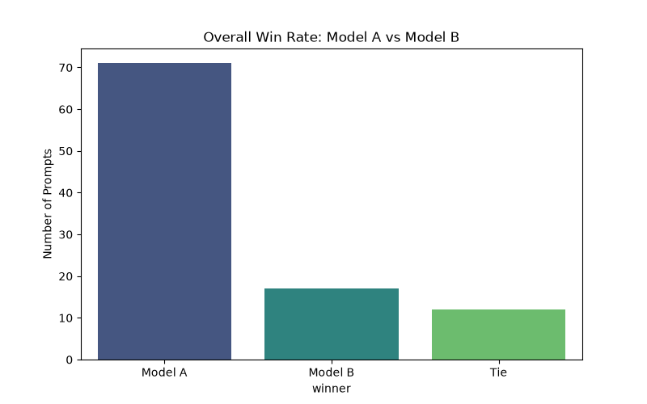
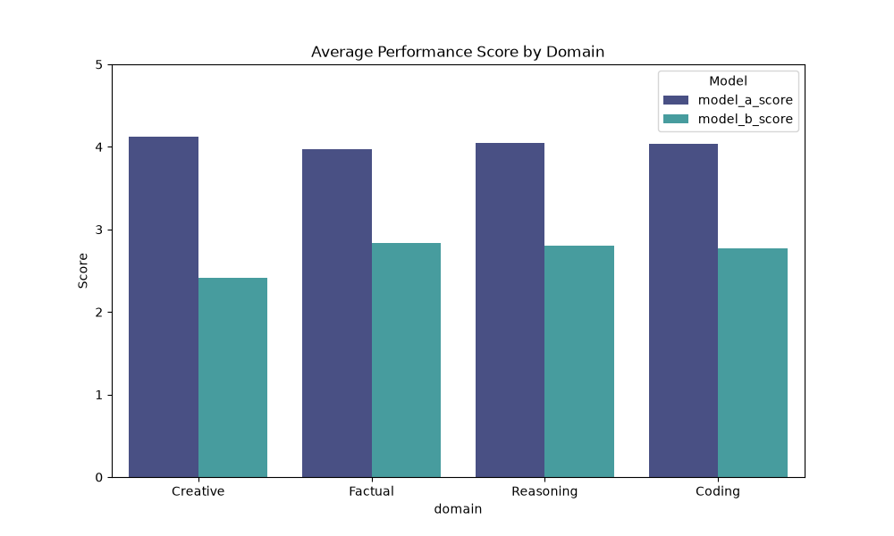

# AI Response Evaluation Benchmark

An end-to-end evaluation pipeline assessing Large Language Model (LLM) outputs across mixed domains using a strict 1-5 quality rubric. This project demonstrates prompt engineering, human-in-the-loop (HITL) evaluation, and data analysis.

## Project Scope
- **Domain:** Mixed (Reasoning, Coding, Creative, Factual)
- **Volume:** 100 prompt comparisons (Model A vs. Model B)
- **Deliverables:** Evaluation dataset, scoring rubric, written rationales, and Python-based performance analysis.

## Methodology
Each prompt was evaluated blindly against two model outputs. Scores were assigned based on accuracy, constraint adherence, and formatting. A detailed rationale accompanies each score to justify the grading and capture nuanced model hallucinations or omissions.

## Performance Visualizations

### Overall Win Rate

### Performance by Domain

